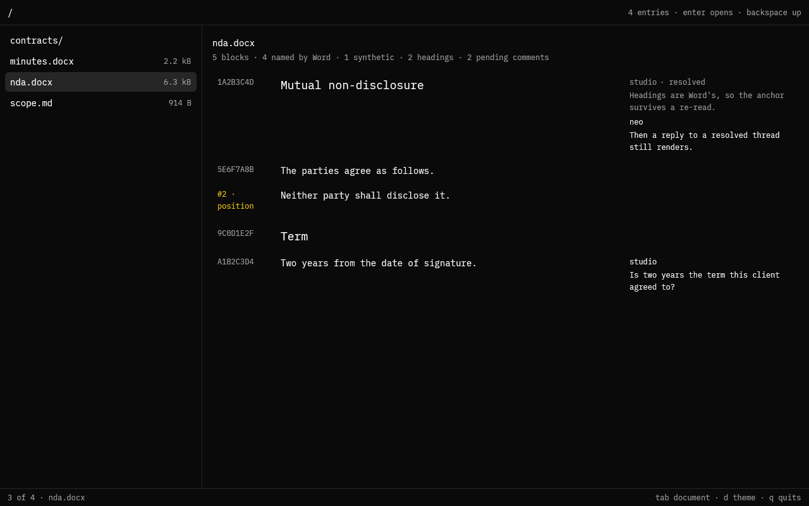

# doc-shell, as a Spore

The first slice of `apps/doc-shell` on the Spore side of the boundary: a vault on
the left, a Word file on the right, and every paragraph shown by the identity
Word already wrote into it. It is a `wasm32-wasip2` component that draws its own
window, built against the fork's headless `gpui` — the same host loop the finder
uses.



That frame is the **`demo`** build, captured by `soil-webgpu`, because the host
that presents Spores does not link `soil:vfs` yet. The document in it is a real
`.docx`: `src/data.rs` writes the zip in memory, so the frame exercises the
shipped reader rather than a stub.

## One reader, no database

A `.docx` is a zip whose `word/document.xml` is the outline. Two things make it a
document rather than a blob: paragraphs carry an identity (`w14:paraId`, a 32-bit
hex number Word maintains) and a style name. So:

- **the guest parses it**, from bytes `soil:vfs.read` hands over;
- **the identity is the container's**, so two readers of the same bytes agree
  without a store between them — which is what makes an anchor ("this reply is on
  `1A2B3C4D`") resolvable by anyone holding the file;
- a paragraph Word did not name gets `#n · position`, rendered in the warning
  colour, because an identity derived from position is not the same claim as one
  Word wrote.

`fungos-vfs` reads the same container in the native app; that reader is the one a
host capability would own if we ever want the parse in one place. Nothing in this
slice needs it.

## Reading, and only reading

| grant | why |
| --- | --- |
| `soil:vfs` | list one workspace, read the bytes of the document it opens |
| `soil:present` | the offscreen surface, keyboard input, the cursor |
| `wasi:webgpu` | one offscreen device; the host keeps the adapter and the swap |

Saving a document and writing a thread anchor are mutations, and this slice
declares neither. See [What is not here yet](#what-is-not-here-yet).

## Build

```sh
# the package: module.wasm + spore.lock (+ a tar with --tar)
./scripts/package.sh --tar

# look at the arrangement without a host that links soil:vfs
cargo build --release --target wasm32-wasip2 --features demo
soil-webgpu --frame /tmp/doc.bgr --size 1280x800 \
  target/wasm32-wasip2/release/doc_shell_guest.wasm
```

A Spore gets no window and no device handle it can keep: it renders offscreen and
hands the host a texture. `soil:present/input` is the only keyboard.

## What is not here yet

- **Saving.** `cmd-s` needs `soil:vfs-mut`; the record of *who* saved comes from
  `soil:principal` the host already attests.
- **Threads.** A reply is anchored to a block id, and a thread has three fates:
  it is *pending* (live, syncing, attached), it is *committed* into the durable
  artifact, or it is gone. "Render the same" is the requirement that decides the
  shape: a committed comment has to keep its provenance — comment id, author,
  time, the block it was on — or the view cannot draw it like the ones that are
  still pending, and nobody can tell it began life as a comment.

  Where pending threads live follows where the artifact lives, so a commit can
  be one transaction rather than two:

  | target | pending in | commit |
  | --- | --- | --- |
  | transcript (a records book) | `soil:records`, one record per comment | append the durable entry and drop the pending record, in one store |
  | document or sheet (bytes in the namespace) | `soil:vfs-mut`, per-actor files | not a commit: resolving is the end of a comment |

  A doc comment is *accepted into the text* on save, which is why it has no
  agent-facing commit step: nobody reads a spreadsheet as instructions. A
  transcript comment is the opposite — committing is what puts it where an agent
  will read it, so it must never be lost and never be ordered after the reply it
  answers.

  This slice implements neither. It only guarantees the precondition: block
  identity survives a re-read, so an anchor written today still resolves when the
  comment is rendered from the artifact rather than the store.
- **The transcript pane** and **preferences**: layout is per-device view state,
  which is what `soil:appdata`'s `local` scope is for.
