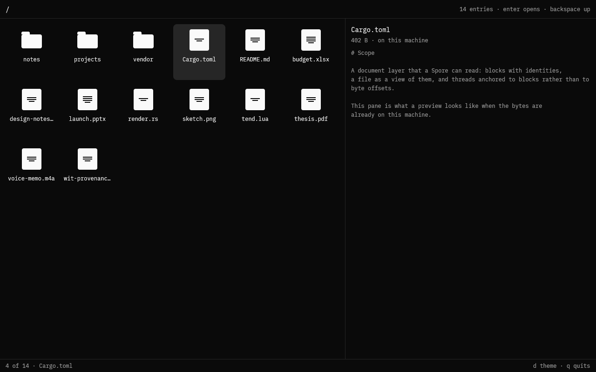

# xplorer

A file manager as a Spore. Lists one granted workspace, previews what is
selected, and knows nothing else: no filesystem, no network, no process, no
clock.

```sh
cargo build --release --target wasm32-wasip2
# → target/wasm32-wasip2/release/xplorer.wasm  (a component, ~18 MB)
```

## What it reads

One capability, `soil:vfs`, and it is the same call for both halves of the
window:

- `ls(parent, offset, limit)` fills the grid, and each row carries the host's
  `hydration` — so a file whose bytes live on another machine says so instead of
  hanging when it is selected;
- `read(path, offset, length)` fills the preview, at a budget (24 KiB) rather
  than the whole object, and the pane says when there is more;
- every entry also carries a `content-id`, which is what a later image or media
  preview will hand to `soil:storage` once that grant is linked.

Nothing here walks a disk, and a path the host does not grant simply does not
exist — which is why this Spore cannot show somebody else's files even by
accident.

## What it draws

GPUI, headless, rendered into the host's surface: a grid of tiles on the left,
preview on the right, the path as breadcrumbs in the header, hints in the footer.
A tile is an icon over a name, the way a Finder window or a launcher reads, and
the grid wraps to whatever width the surface reports — the same number tells the
arrow keys how far a row is, so `Down` moves down the grid rather than down a
list that is no longer there.

Dark by default, and `d` toggles the theme: the palette is the kit's, so one
`Theme::change` moves every colour and the icons are drawn in the same two
tokens either way.

Keyboard first — arrows move, `Enter` descends, `Backspace` goes up, `r` reloads,
`d` toggles the theme, `q` quits. A pointer is not hit-tested yet: the reviewable
part is the data flow, and a hover that silently changes the selection would be
worse than no hover.

## Why it is not in this repository's workspace

A Spore is a `wasm32-wasip2` component built against the headless `gpui` in
`fungOS-linux/gpui-fast`, with components from `fungOS-linux/gpui-kit`'s
`gpui-component`. The native apps here build against the desktop platform of a
different `gpui`. Different crates, so this crate has its own `[workspace]`,
lockfile and target directory.

## What it looks like



That frame is real: `soil-webgpu` compiled the component, instantiated it against
`soil:present`, and captured the surface it presented. It is the **`demo`** build
against a fixed listing (see `src/data.rs`), because the host's Spore world does
not import `soil:vfs` yet — the shipped build imports it and needs the grant.

## What it still needs before the shipped build can be seen

A host must link `soil:present` (surface, input, cursor) **and `soil:vfs`** and
then call `run`. `crates/soil-webgpu/wit/runner.wit` is where that import is
missing; its state type then has to implement `soil:vfs/vfs::Host` — which
`crates/soil-vfs-host`'s `VfsHost` already does — and the runner needs a
`--root <workspace>` to open.

`crates/soil-vfs-host` in soil already implements `soil:vfs` and `soil:index`
over `fungos-vfs`, and `crates/soil-webgpu` already presents a component's
frames — but no binary composes the two. That runner is the next piece:
`--root <workspace> --frame <file.bgr> --size WxH <component.wasm>`.

## Later

- pointer hit-testing, tabs and split panes;
- `soil:index` behind a command palette (substring → fuzzy → full-text →
  semantic are all the host's already);
- `soil:records` for the desktop tree and for transcripts as first-class rows;
- `soil:storage` for image and media previews by content id;
- `soil:spore.launch` so a document opens in the editor instead of a preview.
