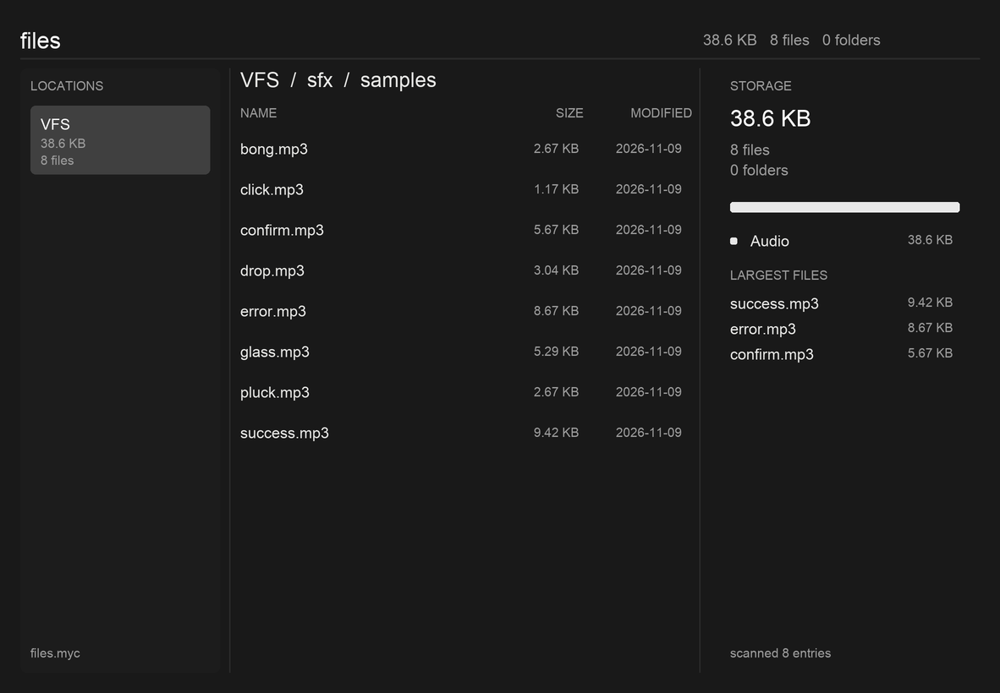

# files

A VFS browser and storage census: how much data a location holds, what it is
made of, and what is in the folder you are looking at. The first slice of a
files.myc that is meant to grow into a Finder-class viewer — and, later, a place
to decide what to back up or project somewhere else.



The picture is rendered from the real scene document (`tools/shot.lua`), so the
layout and the copy are the ones a host is handed rather than a mockup. The font
in the picture is the preview rasterizer's; Canvas draws with its own.

## What works today

- **A location rail.** Each location is a namespace root with its own totals.
  `files-serve` defaults to the fungOS VFS workspace; `--root` adds a local
  directory tree for development and tests.
- **A directory listing.** Directories first, then names. Size and modification
  date per row. Directories are pressable; a breadcrumb is the way up.
- **A census.** Total bytes, file count, folder count, a stacked bar by media
  class with a legend, the largest files, and an honest footer: entries scanned,
  whether a budget cut the walk short, and how many folders could not be read.
- **files.myc.** `files-serve` renders the same Lua view Canvas runs and serves
  it in a browser, with click-through navigation. Nothing is redrawn when a poll
  comes back unchanged.

### The VFS, not the disk

`files-serve` reads `<workspace>/.fungos/vfs.sqlite3` read-only. The default
workspace is `$FUNGOS_HOME/vfs`, usually `~/.local/share/fungos/vfs`. The page
lists the VFS namespace — the paths and metadata the VFS owns — not the machine's
home directory. `--root name=dir` is the opt-in local-directory adapter; it does
a real recursive census, so it is for small trees and for the tests, not the
installed service.

A folder click is one bounded query over the namespace, not a `read_dir` of
every descendant. That is the difference between the VFS page (tens of
milliseconds) and a large local tree (seconds, and a gateway timeout when the
tree is large enough).

```
$ ./target/debug/files-serve --vfs "$HOME/.local/share/fungos/vfs"
files-serve: VFS=/Users/me/.local/share/fungos/vfs on http://127.0.0.1:8803
```

Add the gateway route so `files.myc` resolves:

```json
{ "name": "files", "hosts": ["files.myc"],
  "upstream": "http://127.0.0.1:8803", "service_kind": "files",
  "priority": 10, "dock": true,
  "remote_token_file": "/Users/me/.mycelium/gateway/files-remote-token" }
```

in `~/.mycelium/gateway/routes.json`. `*.myc` already resolves to loopback
through `/etc/resolver/myc`; the route is the whole of the DNS story. The
installer writes this route for you.

### One name, anycast

`files.myc` is a Mycelium gateway name, not a port someone memorized. A running
`files-serve` publishes an application lease in
`~/.mycelium/application-services.json` and renews it every minute. Mycelium
caps a lease at 300 seconds; the installer also passes `--lease-scan`, so the
service runs `mycelium scan` beside the renewal and myceliumd reads and gossips
the observation. The gateway resolves `"service_kind": "files"` from that
catalog. Stop the service and the entry stops being renewed; it expires within five minutes.

Candidate order is local first: this machine's loopback upstream, then fresh
leases from other nodes, then configured fallbacks. A discovered peer must
advertise a reachable, non-loopback endpoint. The installer advertises every
non-loopback IPv4 address by default and creates the `remote_token_file` the
gateway requires before it dials a discovered peer. That token is a route
credential, not an ACL: `files-serve` is read-only and treats the mesh as its
boundary. Use `--advertise URL` to choose the endpoints, or
`--bind 127.0.0.1:8803 --no-anycast` to keep a machine local.

Each machine still serves its own census under the same name; anycast is the
fallback, so one name works from every machine that installed the service.

### Install it as a service

`tools/install.sh` builds the host, copies the view, renderer, theme and the one
SDK library it needs into `~/.local/share/fungos/files/`, installs a per-user
LaunchAgent (macOS) or systemd user unit (Linux), publishes the `files` lease,
and adds or updates the `files.myc` route. With no arguments it opens the
standard VFS workspace:

```sh
spores/files/tools/install.sh
```

The first location is the one the page opens on. Pass `--vfs name=dir` to choose
another workspace, or `--root name=dir` to add a local directory to the rail.
The service binds `0.0.0.0:8803` and advertises the host's non-loopback
addresses by default. Rerun with
`--advertise http://host:8803` to pin the advertised endpoint, or with
`--bind 127.0.0.1:8803 --no-anycast` to keep the service on this host.
`--uninstall` removes the service, route, token and this application's lease
observation while leaving other applications' observations alone;
`--dry-run` prints the command, endpoints and paths first.

Check both halves:

```sh
mycelium services --kind files --json
curl -k "https://files.myc/scene.json?w=400&h=300"
```

A peer with the route and no static upstream resolves `files.myc` through the
same lease; the gateway log names the candidate it dialed.

On macOS the service is a background process. With the default VFS backend
there is no disk permission to grant. If you opt into `--root` local folders,
the system withholds protected folders (Photos Library, Music, Downloads,
Documents) until `files-serve` has Full Disk Access; the census reports each
folder it could not read rather than counting it as empty. Grant it once in
System Settings → Privacy & Security → Full Disk Access, then restart the
service.

## Where the data comes from

The Spore reads a `Vfs`: a host-supplied, workspace-relative, paged namespace
whose shape is `soil:vfs@1.0.0`. It lists entries (path, name, kind, size, media
type, modification time) and never reads bytes. That is the grant: a census that
cannot see content cannot leak it.

Three adapters exist:

| Adapter | Used by | What it is |
|---|---|---|
| `vfs_scan` | `files-serve` (default) | the fungOS VFS namespace (`vfs.sqlite3`), read-only; totals and listings come from the namespace, not a disk walk |
| `StdFs` | `--root` | a real directory tree, with the workspace boundary and a no-symlink-follow policy enforced in the adapter |
| `MemoryVfs` | tests | the same paging contract, including the errors |

The module `spore.toml` declares is the same crate compiled against the real
`soil:vfs` when a Soil host links it. `spores/markdown` has the same gap: the
manifest names `module.wasm`, and the guest build that produces it belongs to
the Soil toolchain. `files-serve` is the host stand-in until then — it supplies
the adapter, not the semantics.

`spores/files` is first-party: it lives in this repository and CI runs its view
and host tests. `soil-store index` still skips it, because a Store package
requires `module.wasm`; the service installer is the supported install path
until the guest build lands.

## Build, preview, test

```sh
cargo build -p spore-files
./target/debug/files-serve --once                            # the VFS snapshot Lua
./target/debug/files-serve --vfs "$HOME/.local/share/fungos/vfs" --sdk "$FUNGOS_SDK"

# The opt-in local adapter, for a small tree:
./target/debug/files-serve --root studio=~/src --once

# The same view, rendered straight to a scene document:
lua ../../tools/shot.lua ui/files.lua examples/files_mock.lua \
  ../themes/graphite.lua /tmp/files.json 1182 820

cargo test -p spore-files
FUNGOS_SDK="$FUNGOS_SDK" lua tests/ui_fixture.lua
```

`--once` needs no Lua and no SDK: it prints exactly the table the view would be
handed. `--snapshot <file>` renders a saved snapshot instead of scanning, which
is how the view is iterated without waiting on a disk.

`files-serve` flags that matter on a big tree: `--max-entries` (default 100,000),
`--max-depth` (default 24), and `--refresh` (seconds a scan is reused, default
20). A scan that hits a bound says so in the footer; it never presents a partial
sum as the whole.

## Why it is split this way

Rust owns the census; Lua owns every pixel. The seam is one flat table
(`ui/API.md`), so an agent can restyle a running app without rebuilding the
module, and the same table feeds Canvas on the wall and the browser page.

The three panes are arithmetic, not a layout library. Canvas has no layout
service, and a flow engine inside one Spore would be a second layout
implementation with one caller. Text is measured through `surface:measure_text`,
so what the view reserves and what the host draws use one number.

The node budget is real: Canvas rejects a scene over its combined node ceiling.
The view plans at most 22 rows of three nodes each, and the fixture fails if the
scene exceeds 256 nodes.

## Where this goes

The census is the half that has to be right before anything moves:

1. **Selection and open.** A file row is deliberately not pressable; opening one
   is a `soil:vfs.read` grant this Spore does not hold. The next slice adds a
   preview Spore (or a host-owned viewer) rather than widening this grant.
2. **Backup to S3 / R2.** The same snapshot is a manifest: content IDs, sizes,
   and the class census are what a backup planner needs to decide what changed.
   The transport belongs to a separate Spore with `transport` and a lease, not to
   a viewer holding `soil:vfs`.
3. **Projections.** Google Drive, iCloud, and Resilio Sync are the same planner
   with different targets. The location model already carries per-root totals,
   which is what "how big is this shared desktop, and what is in it" needs.
4. **A real Finder.** Search (`soil:index`), thumbnails, drag/drop, multiple
   selection, and sort controls are view and grant work, not a second census.

## Known gaps

- **No wasm artifact yet.** See "Where the data comes from". The UI, the
  census, the manifest and the host path are real; the guest build is pending.
- **The scan is a full walk.** Fine at a hundred thousand entries, wrong at
  millions. `soil:index` is the derived structure that replaces it.
- **No file open, no selection, no scroll.** The view windows the listing to the
  rows a window holds and says how many it is showing.
- **Roots are host paths today.** Under Soil they become workspace mounts; the
  snapshot already models them as named locations with independent totals.
- **The page polls every five seconds.** Scans are cached for `--refresh`; a
  push channel is the host's job, not the page's.
