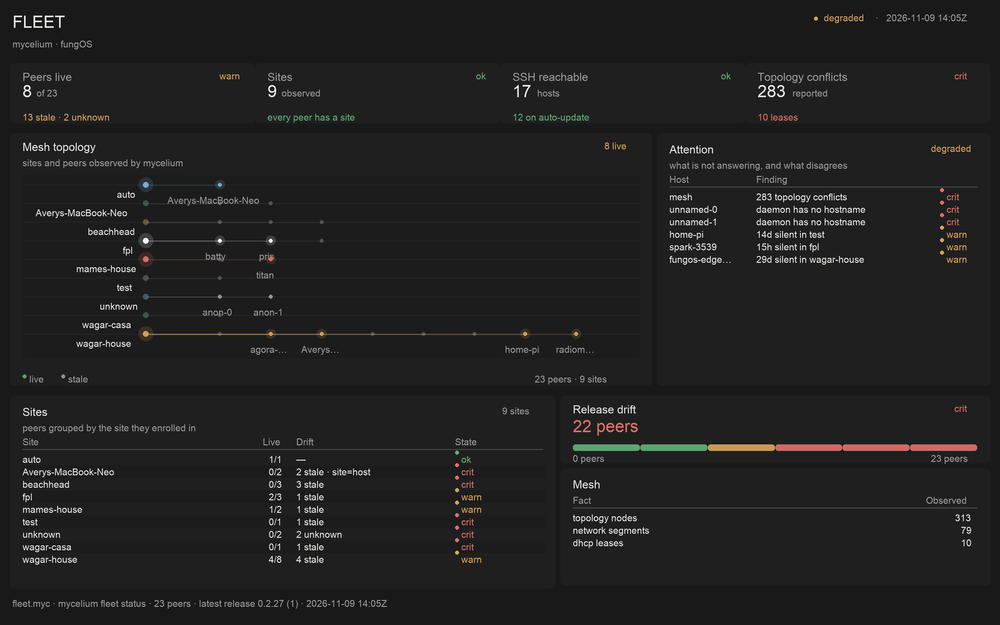

# fleet

One wall for the mycelium environment: which peers are alive, where they sit,
what the mesh has observed, and what is not answering.



The picture is a fixture captured from the real fleet, not a mock: the stale
laptops, the anonymous daemon rows, and the 283 topology conflicts are what
`mycelium fleet status --json` and `mycelium topology --json` returned on
2026-11-09.

## Two halves

A view is a projection, so the split is the one the worklog already uses:

```text
mycelium fleet status --json \
mycelium topology --json    ──▶ spore-fleet (Rust)  ──▶ snapshot (Lua table)
                                                        │
                                              ui/fleet.lua (the Spore)
                                                        │
                                    ┌───────────────────┴───────────────────┐
                                    ▼                                       ▼
                            Canvas / wall                            fleet-serve
                                                              (http://fleet.myc)
```

- `src/lib.rs` owns the semantics: dedupe a peer that appears twice, decide
  what "stale" means, group sites, lay out the graph, and shorten a label to the
  column that has room for it. It is a pure function of (status rows, topology,
  now), so the wall, the browser and the fixture cannot disagree.
- `ui/fleet.lua` owns the presentation. It reads no clock, socket or file; it
  paints the snapshot with `fungos.ui`.
- `src/bin/serve.rs` is the host. It reads the daemon's JSON (or a committed
  snapshot), runs the same Lua through `tools/shot.lua`, and serves the scene
  document to a browser. It is a native process because reading the daemon and
  speaking HTTP are exactly the authorities a Spore must not hold.

The Spore itself is Lua-only (`target = "soil"`): the host resolves peer facts
before the snapshot reaches the view, so there is no guest ABI to widen.

## Run it

```sh
cargo build -p spore-fleet --release

# Capture the daemon's two documents
mycelium fleet status --json   > /tmp/fleet-status.json
mycelium topology --json       > /tmp/fleet-topology.json

./target/release/fleet-serve \
  --status /tmp/fleet-status.json \
  --topology /tmp/fleet-topology.json
# fleet-serve: ... on http://127.0.0.1:8804
```

Open `http://localhost:8796`. The route that makes it `fleet.myc` is one entry
in `~/.mycelium/gateway/routes.json`; `*.myc` already resolves to loopback, so
the route is the whole DNS story:

```json
{ "name": "fleet", "hosts": ["fleet.myc"],
  "upstream": "http://127.0.0.1:8804", "priority": 10 }
```

The gateway certificate is generated when the gateway is installed and lists the
routes that existed then. A route added afterwards is served, but the name is
not in the certificate's SANs, so browsers warn until the gateway is reinstalled
with the route in place (which regenerates the local CA and needs the new one
trusted). This is a gateway gap, not a Spore one: `fleet.myc` is reachable and
serving while the certificate catches up.

A committed snapshot needs no daemon:

```sh
./target/release/fleet-serve          # serves examples/fleet_snapshot.lua
```

On the wall, the same view is a composed Canvas module:

```sh
lua tools/compose_fleet.lua "$HOME/Library/Application Support/Dock/canvas/modules"
# spore-dev-fleet.lua + .json; the launcher opens it as a window
```

## The graph

The topology card is `ui.graph`:

- **Positions are data.** `spore-fleet` lays out one row per site and a host row
  to its right; the library draws the coordinates it is given. A force layout or
  a GPU layout can replace the producer without touching the view.
- **Only sites and live peers are named.** A stale dot is a fact (the row
  exists); its name is not what a wall needs, and the attention table carries it.
  The library fits each remaining label to the gap it actually has, and the
  producer no longer truncates names before the library can measure them.
- **Edges are rotated rects**, one node per edge, so the same graph renders on
  Canvas's current rect/text ABI, in the browser and in the preview.
- **A GPU producer takes over by grant.** The producer names
  `graph.resource = "fleet.topology"`; the host sets `module.inputs.graph_surface`
  when it can place one, and `ui.graph` emits `canvas.host_resource` instead of
  marks. The wall then draws the native GraphGPU layer and the Spore never sees a
  pixel. Until such a host exists the marks are the honest path, not a fallback
  that pretends to be the GPU version.

The scene schema already carries `polyline` and `points`, and `soil-scene-gpu`
renders them natively. What is missing is two halves in the Lua path: a graph
node that emits those instead of rotated rects, and a Canvas bridge that stops
degrading them to `Group` — see
[`docs/gpu-surfaces-in-lua-ui.md`](../../docs/gpu-surfaces-in-lua-ui.md).

## The wall budget

The fixture is **251 primitives**, under the stock Canvas cap of 256. That
number is an assertion in `tests/ui_fixture.lua`: a view that grows one more
panel has to give something up, not discover the limit on the wall. It is a
fixture, not a guarantee: each live peer adds a label and a halo, and each peer
adds a dot and an edge, so a fleet past roughly twenty-five live peers needs
the frontier Canvas's 1024-node ceiling (or fewer labels). The live capture on
the day this landed sat at 248.

## Refresh the fixture and the screenshot

```sh
mycelium fleet status --json > /tmp/fleet-status.json
mycelium topology --json     > /tmp/fleet-topology.json
cargo run -p spore-fleet --bin fleet-serve -- \
  --status /tmp/fleet-status.json --topology /tmp/fleet-topology.json \
  --print > examples/fleet_snapshot.lua

FUNGOS_SDK=../.. lua ../../tools/shot.lua ui/fleet.lua \
  examples/fleet_snapshot.lua ../themes/graphite.lua /tmp/fleet.json 1600 1000
python3 ../../tools/shot.py /tmp/fleet.json screenshot.png 1600 1000
```

## Tests

```sh
cargo test -p spore-fleet            # classification, dedupe, Lua projection
lua tests/ui_fixture.lua             # the view, the graph and the 256-node budget
node tests/page_smoke.mjs /tmp/fleet.json   # the browser page draws the document

# The artifact Canvas actually loads, checked against the host contract:
lua tools/compose_fleet.lua /tmp/fleet-modules
lua ../../tools/check-module-contract.lua /tmp/fleet-modules/spore-dev-fleet.lua
```

`tools/capture.sh` does the two `mycelium` reads in one step.

## Known gaps

- **The snapshot is captured, not streamed.** `fleet-serve` re-reads the JSON
  when its mtime changes, but nothing writes that file for it. A live view wants
  `mycelium topology watch` (or a records-backed feed) behind the host.
- **`soil:mycelium.read` does not exist yet.** The projection lives in the host
  because there is no Soil grant that hands a Spore peer facts. When there is
  one, `src/lib.rs` moves behind it and the view does not change.
- **The graph is a layered tree, not a force layout.** A site-and-host tree is
  what a fleet is read by; a force graph would be prettier and less answerable.
- **No interaction wiring.** Nodes and rows register host-owned hit regions
  (`fleet-inspect-peer`, `fleet-filter-site`), but nothing consumes the actions
  yet: opening a peer means a terminal or an SSH hand-off, which is its own
  decision.
- **The fixture is a moment.** Its `captured` line is the daemon's newest
  `last_seen`; a snapshot with no `--now` is classified against that instant.
