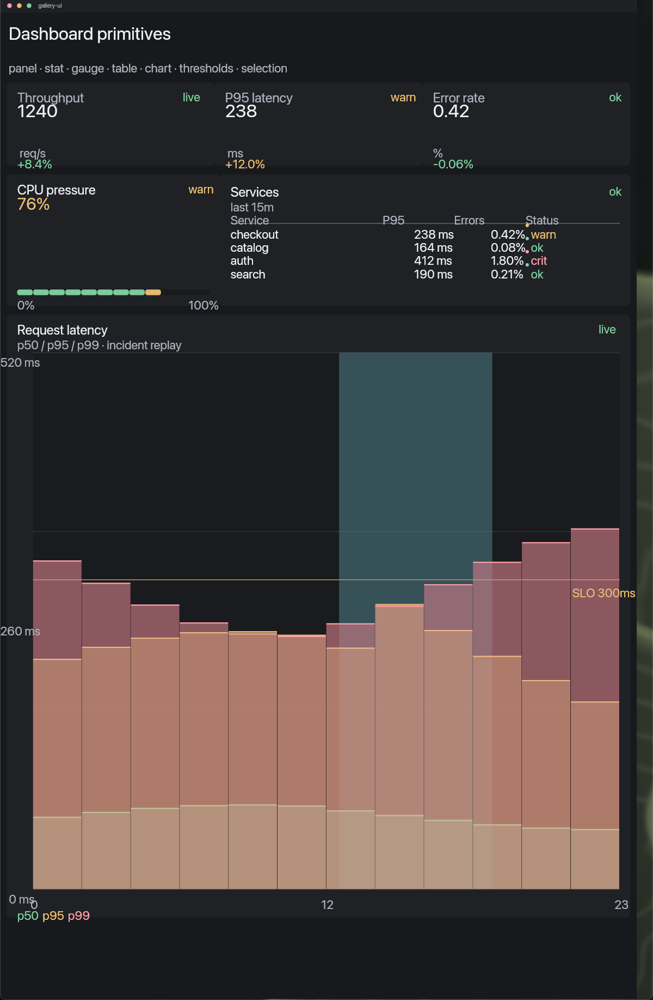

# Gallery

Fixture-driven catalog for the dashboard nodes in
[`sdk/ui/ui.lua`](../../sdk/ui/ui.lua). It is UI-only: the Spore owns composition,
not metrics, alerts, or authority.



## What it exercises

- `ui.stat` — value, unit, delta, status, and an optional drill-in action.
- `ui.gauge` — segmented threshold meter with a value and range labels.
- `ui.table` — title, subtitle, status, proportional columns, zebra rows, and
  optional per-row actions.
- `ui.chart` — title, status, axes, grid, threshold line, selection band, series
  legend, and optional legend/plot actions.
- Shared tokens for ink, spacing, radius, and type. Canvas's Lua scene ABI has a
  smaller semantic ink set than the library, so the library normalizes aliases
  such as `surface_sunken` and `divider` before emitting primitives.

The view uses one fixture (`ui/gallery.lua`) so a visual change is a deliberate
change to the component, not a change in live data.

## Run

```sh
cd spores/gallery
lua tests/gallery_fixture.lua
```

The fixture stubs `canvas.rect`, `canvas.text`, and `widget.button`, enables
`ui.debug` so each node must draw inside the box it claimed, and asserts that
every dashboard primitive and hit region was emitted. It runs without a
compositor.

To preview in Canvas, compose `sdk/ui/ui.lua` with `ui/gallery.lua` into a module
and give the module manifest action grants for `inspect-stat`, `inspect-gauge`,
`open-service`, `toggle-series`, and `select-range`. Actions are optional in the
view; omit them when a module has no action route.

## Boundary

`ui.lua` is the general structure/token layer. Stat, gauge, table, and chart are
metric-visualization nodes built on that same tree, not a second styling dialect.
Canvas remains the compositor and owns hit regions, pixels, and windowing.
