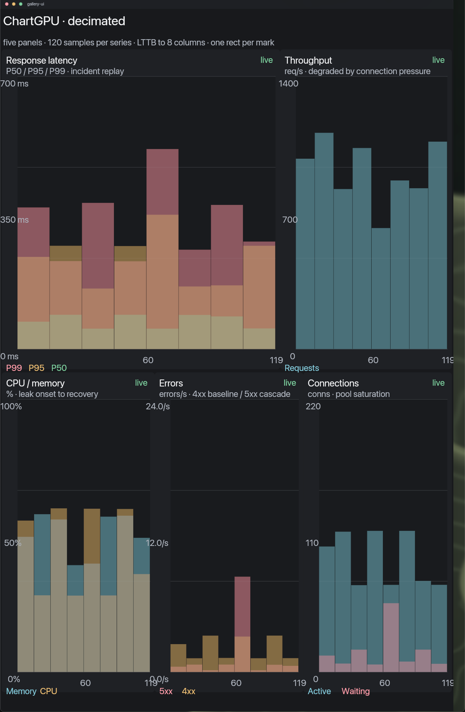

# Gallery

Fixture-driven catalog for the dashboard nodes in
[`sdk/ui/ui.lua`](../../sdk/ui/ui.lua). It is UI-only: the Spore owns composition,
not metrics, alerts, or authority.


The capture predates the graph card; `ui/gallery.lua` and the fixture check it
even though this image does not show it yet.

## What it exercises

- `ui.stat` — value, unit, delta, status, and an optional drill-in action.
- `ui.gauge` — segmented threshold meter with a value and range labels.
- `ui.table` — title, subtitle, status, proportional columns, zebra rows, and
  optional per-row actions.
- `ui.chart` — title, status, axes, grid, threshold line, selection band, series
  legend, and optional legend/plot actions.
- `ui.graph` — typed nodes and edges with positions as data. Edges are rotated
  rects so the current ABI draws them, and a `resource` places a host GPU surface
  instead. The catalog fixture exercises rails, per-node size, label placement,
  live/stale inks and node hit regions.
- Shared tokens for ink, spacing, radius, and type. Canvas's Lua scene ABI has a
  smaller semantic ink set than the library, so the library normalizes aliases
  such as `surface_sunken` and `divider` before emitting primitives.

The view uses one fixture (`ui/gallery.lua`) so a visual change is a deliberate
change to the component, not a change in live data.

## ChartGPU fixture



`ui/chartgpu.lua` is the portable fallback for the five-panel ChartGPU layout.
It uses ordinary `ui.chart` nodes: each series has 120 source points, decimated
with LTTB to 8 columns before the scene is emitted, and `caps = false` keeps one
rect per mark so all five panels fit the default Canvas budget.

This is **not** the native GraphGPU host. The live 60 Hz version is the
`chartgpu-dashboard` Spore in `~/src/spores/spores/chartgpu-dashboard`, run through
`soil-viz`; it uses resident streams and a GPU renderer rather than one rect per
mark.

Run it headlessly with:

```sh
lua tests/chartgpu_fixture.lua
lua tests/host_surface_fixture.lua
```

## Run

```sh
cd spores/gallery
lua tests/gallery_fixture.lua
```

The fixtures stub `canvas.rect`, `canvas.text`, and `widget.button`, enable
`ui.debug` so each node must draw inside the box it claimed, and assert that
every dashboard primitive and hit region was emitted. They run without a
compositor. The gallery test also covers LTTB endpoints/spike preservation and
the streaming window helper.

To preview in Canvas, compose `sdk/ui/ui.lua` with `ui/gallery.lua` into a module
and give the module manifest action grants for `inspect-stat`, `inspect-gauge`,
`open-service`, `toggle-series`, and `select-range`. Actions are optional in the
view; omit them when a module has no action route.

## Soil document backend

`ui.present(tree, theme)` is the Lua peer of the Rust
`soil_sdk_canvas::Surface::present_scene`: it builds one `soil_scene::Present`
document, calls `canvas.present` (or `soil.canvas.present`), and lets the host
render it. `ui.document(tree, theme)` returns the same document without touching
a host, so a test or a relay can inspect it. The legacy `ui.render` path is the
compatibility fallback when the host has no `canvas.present`.

Run the document check with:

```sh
lua tests/soil_fixture.lua
```

## Boundary

`ui.lua` is the general structure/token layer. Stat, gauge, table, and chart are
metric-visualization nodes built on that same tree, not a second styling dialect.
Canvas remains the compositor and owns hit regions, pixels, and windowing. The
Rust and Lua SDKs share the scene document shape; only the host-call spelling
differs (`soil:canvas/surface.present` versus `canvas.present`).
