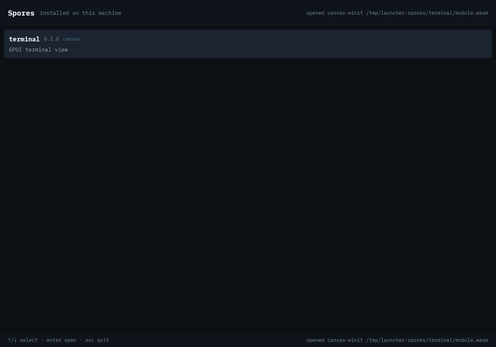

# launcher-gpui

The installed-Spore launcher, rendered by GPUI inside a Spore.



```sh
cargo build --release --target wasm32-wasip2
canvas-winit target/wasm32-wasip2/release/launcher_gpui.wasm --spores ~/Library/Application\ Support/fungOS/spores
```

Arrow keys move, enter asks the host to open the selected Spore, escape quits.
The host scans `--spores DIR` for `<name>/spore.toml`, lists each package, and
`launch` starts `canvas-winit <module>` in a new window. The launcher never
reads the filesystem or starts a process itself.

The list is the catalog contract (`soil:spore/catalog`); the host owns
discovery and launch. The next steps are pointer input, a real installed root,
and replacing the placeholder chrome with GPUI-kit components.
