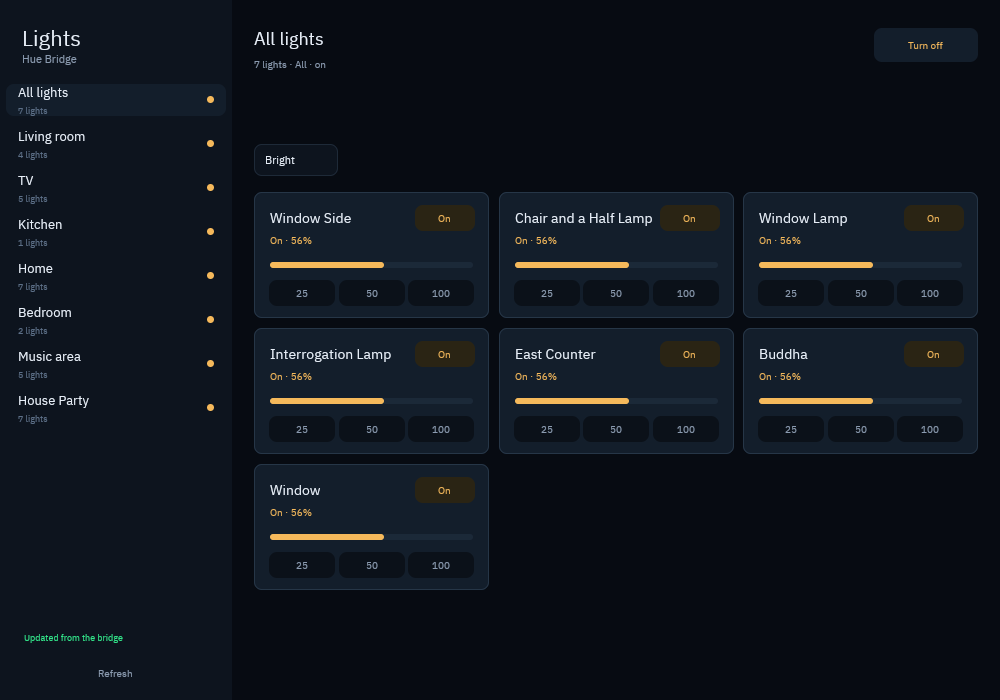
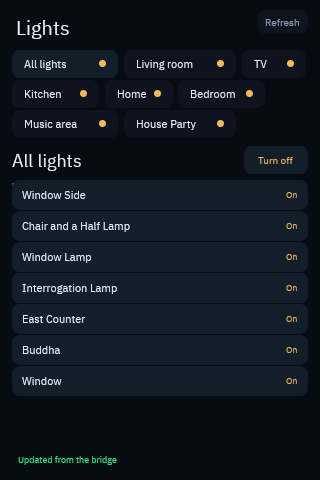

# lights-view

A room-first Philips Hue controller rendered by GPUI inside a `wasm32-wasip2`
Spore. The Spore owns the pixels and the Hue semantics; Soil owns the window,
the pointer stream, the origin allowlist, and the bridge key.





## What it shows

- **Rooms** from the bridge's groups, with the bridge's all-lights group first.
- **Scenes** scoped to the selected room; never a scene from another room.
- **Lights** as cards with power, a brightness meter, and 25/50/100 presets.
- **Watch mode** below 560 px tall: room chips, a group power switch, and one
  toggle row per visible light.

When a request fails, the last snapshot stays on screen and the status line
reports the bridge error. The view never fabricates an off state or a zero
brightness for a light the bridge did not report.

## Run

Build and launch through the real Soil presenter, not a browser wrapper:

```sh
cargo build --release --target wasm32-wasip2
cp target/wasm32-wasip2/release/lights_view.wasm module.wasm
soil-spore lock . && soil-spore check .

canvas-winit module.wasm \
  --hue-bridge http://192.168.10.15 \
  --geode-socket ~/.geode/geode.sock \
  --geode-purpose hue.control
```

`--hue-bridge` binds the `hue.local` capability to the bridge. Moving the
bridge does not require rebuilding the Spore. The guest names
`geode://home/hue/bridge`; the host leases that entry and substitutes it into
the Hue v1 path. The key never enters Wasm, `spore.toml`, a record, or argv.
When this Spore is opened from the Spore launcher, start the launcher with the
same `--hue-bridge` and Geode flags so the child inherits the grant.

## Input

- click a room, scene, light, or preset
- `up` / `down`: previous/next room
- `space`: toggle the selected room
- `r`: refresh the bridge snapshot
- `escape`: quit

## Build

```sh
TMPDIR=/tmp CARGO_TARGET_DIR=/tmp/lights-target \
  cargo build --release --target wasm32-wasip2
```

The GPUI dependency is the local `gpui-fast` checkout because the wasip2
headless renderer is not in a published `gpui`; the wgpu-wasi-webgpu pin keeps
the guest on wgpu 30 while the host remains on wgpu-core 29.
