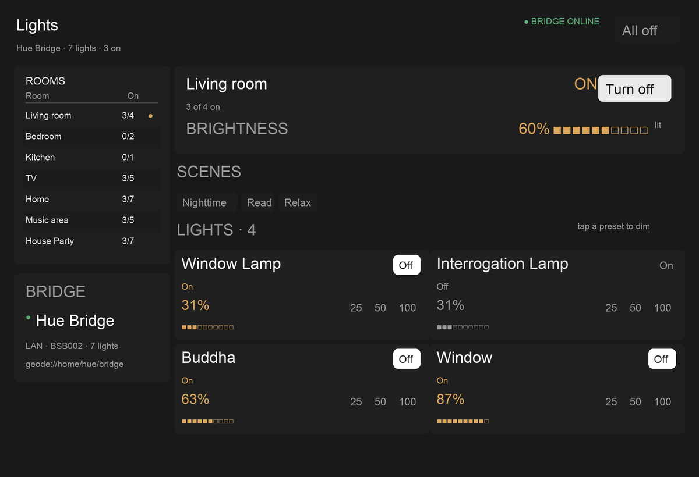

# Lights

A room-first control surface for the local Hue bridge. This package is the Lua
view: it consumes one host-owned snapshot and emits bounded `lights.*` intents.
The host owns the bridge, the Geode lease, and every write.



## Design

The reference apps agree on a shape rather than a skin:

- Apple Home puts rooms and accessory categories first, then favorite
  accessories with state readable at a glance.
- The Hue app is scene-first inside a room and gives each fixture its own
  brightness control.
- Home Assistant's light card is the compact version: state, brightness, and a
  small set of bounded actions instead of a generic form.

This view composes those ideas for a desktop-sized surface:

- a bridge/room rail for navigation, with the selected room explicitly marked;
- one room summary with an on/off action and a room brightness readout;
- scene chips scoped to the selected group, never a global scene dump;
- light cards with name, on/off, brightness meter, and 25/50/100 presets;
- a global "All off" always in reach;
- warm `warning` ink only for lit state, so the room reads at a glance without a
  grid of identical colored tiles.

Ids and names come from the bridge. Counts are derived from actual membership;
the view never infers a room from a name. A group with more than four lights
switches to a denser three-column grid, which keeps the seven-light Home group
inside the 1200x820 authoring surface.

## Preview

```sh
FUNGOS_SDK="$PWD" \
  lua tools/shot.lua spores/lights/ui/lights.lua \
    spores/lights/ui/snapshot.lua spores/themes/graphite.lua \
    /tmp/lights.json 1200 820
python3 tools/shot.py /tmp/lights.json /tmp/lights.png 1200 820
```

`ui/snapshot.lua` is a representative frame using the real bridge names, groups,
and scenes captured on 2026-11-11. Its on/brightness values are set to show both
lit and idle states; the live host replaces them.

## Status

The view, its ABI, and the [`lights-host`](../lights-host) loopback browser host
are in place. The host polls the existing `hue` Spore, renders this view through
`tools/shot.lua`, and routes the actions above back through the Spore. The
fixture is still the shape a new host can assert against without a bridge.
