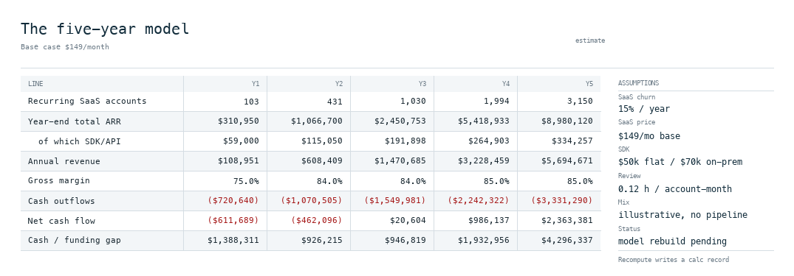
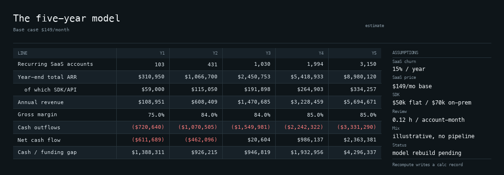

# Sheets Spore

Formula workbooks for Soil. Tabs and published results are records; the
calculation engine is compiled into the module.

```
spores/sheets/
  spore.toml            manifest: id, target, abi, grants
  src/model.rs          tab model, IronCalc evaluation, xlsx bytes (host + wasm)
  src/spore.rs          the wasm component: records in, records out
  wit/world.wit         component world: imports soil:records, exports run
  wit/deps/soil-records.wit  the records interface
  tests/fpl_projection.rs   formula parity against an independent month loop
  tests/pricing_strategy.rs pricing options, comparative multiples and mix label
  ui/sheet.lua          surface entry point: pure projection of a tab
```

## Records

| Schema | Collection | Holds |
|---|---|---|
| `fungos.sheet/workbook@1` | `workbook` | title, tab order |
| `fungos.sheet/tab@1` | `tab` | `{title, cells: {A1: "…"}}` — inputs and formulas |
| `fungos.sheet/calc@1` | `calc` | evaluated values keyed by address |
| `fungos.sheet/xlsx@1` | `xlsx` | exported workbook bytes |

The version lives inside the schema string. The host stores `schema_version` as
`1` and never parses the suffix, so `@2` must be a new string, not a column bump.

## View

`ui/sheet.lua` exports `M.render(context) -> UI tree` against `fungos.ui`,
the same contract as `spores/notes/ui`. It is a pure projection: numbers arrive
already calculated, the view only places them. `ui/snapshot.example.lua` is the
example shape the host builds from the tab and `calc` records. The view does not
use `fungos.action`; recalculation is the Spore's `calc` command writing a
`fungos.sheet/calc@1` record.

Light and dark come from the same tree — the view names theme tokens
(`ink`, `fill`), never a colour:

| Light | Dark |
|---|---|
|  |  |

## Pricing

Three products, not three prices for one product:

| Product | Price | Unit | Buyer |
|---|---:|---|---|
| SaaS small shop | $99 / $125 / $149 per month | Account, 2,000 parts included, $0.10 overage | Small shop, growing shop, bureau |
| Direct / RFQ | $199 per accepted package; $1,500 pilot; $1,500/month team plan with 10 packages | Accepted output | Engineering firm or shop with a blocked part |
| OEM / SDK | $60k list ($40k SDK + $20k API); $50k bundle; $70k on-prem; 18% support | Platform licence | CAD, PLM or manufacturing-software vendor |

The segment table in `tests/pricing_strategy.rs` puts five buyer types against
the SaaS and SDK products. Its 60/25/10/4/1 split is a placeholder until FPL's
pipeline replaces it; cell `P6` says so. The total is a weighted average of
hypothetical prices, not a revenue forecast.

Comparative anchors, checked 2026-11-07:

| Comparable | Public price | Transmog multiple |
|---|---:|---:|
| Autodesk Fusion | $680/year | 2.21× at $125/month |
| Onshape Standard | $1,500/year | 1.00× |
| SOLIDWORKS Design Standard | $2,820/year | 0.53× |
| Creo Design Essentials | $3,350/year | 0.45× |
| PartWork Simple / Complex | $29.99 / $99.99 per part | 6.64× / 1.99× at $199 |
| MiniCAD | $79–149 per part | 2.52–1.34× at $199 |
| Paperless Parts | ~$500–1,500/month | Team plan sits at the top of the range |

CAD Exchanger, the closest SDK comparable, does not publish a price. Its model
is a development/joining fee plus an annual maintenance fee and a per-end-user
machine distribution fee, and its new SDK sales are suspended or restricted in
at least some channels. A flat $50k bundle is therefore a stated simplification,
not a market quote. The $50k bundle is a 16.7% discount to the $60k list. The
break-even includes the 2,000-part allowance and the $1,500 base:
`($50,000 − $1,500) / ($0.10 × 12) + 2,000 = 42,417 parts/month` at $125/month.
The licence is used only when it is cheaper; a 20,000-part account stays on
SaaS plus overage.

The full evidence table is in `research/pricing-comparables-2026-11-07.md` in
fpl-templates. The model is specified by `tests/pricing_strategy.rs`:

- `each_segment_buys_one_product` checks all three SaaS options.
- `bureau_overage_is_the_awkward_segment` shows the $11,100 bureau bill.
- `bundle_discount_and_break_even_are_derived` checks the 16.7% discount and the
  42,417-part break-even, including the allowance and base price.
- `comparative_multiples_are_explicit` checks every multiple above.
- `mix_is_labelled_illustrative_until_a_pipeline_replaces_it` guards the label.

### Pricing preview

The previous pricing render is `preview/pricing-strategy.png`. It still shows the
earlier $120/$150 table and the $515,400 total; it is not current and is not
regenerated by this test run. The current figures are the table above and
`tests/pricing_strategy.rs`. Regenerate the image when the UI host lands.

## Preview

The host that executes `ui/sheet.lua` and draws the tree is not on `main` yet.
The PNGs in `preview/` are earlier static renders, not output from a checked-in
script: the `tools/` preview helpers are not in this worktree. On the `pi/layout`
branch `soil-layout` resolves the tree and `soil-scene` hands it to Canvas, and
the same Lua file will drive that unchanged.

Two node kinds beyond the notes contract carry the spreadsheet look, and a host
has to implement them: `ui.rule(id, {width|height, ink})` draws a hairline, and
`{fill = "surface"}` paints a token behind a row. Grid lines use the `line` ink;
negative money uses `danger`. A dark theme is then the host's token table, not a
second view.

## Commands

```
run ["calc", "<tab-id>"]     evaluate the tab and write its calc record
run ["export", "<tab-id>"]   evaluate, build .xlsx bytes, write them as a record
```

Export goes through records rather than a filesystem: a Spore has no ambient
filesystem, and the host decides how a user receives a file.

## Build and test

```sh
cd spores/sheets
cargo test                                   # model + formula parity, host target
cargo build --target wasm32-wasip2 --release # the Spore module
cp target/wasm32-wasip2/release/sheets_spore.wasm module.wasm
wasm-tools validate --features component-model module.wasm
cd ../..
cargo run -p soil-spore --bin soil-spore -- check spores/sheets
```

`cargo test` is the important one: `tests/fpl_projection.rs` builds a 12-month
projection as spreadsheet formulas and compares every month to a separate Rust
loop. If IronCalc and the formulas disagree, the test fails before anyone opens
the workbook. `tests/pricing_strategy.rs` checks the three SaaS options, the
bureau overage, the SDK bundle discount and break-even, the direct team price,
every comparative multiple and the illustrative-mix label.

## Design notes

- **Calculation is in-Spore.** IronCalc 0.9.1 compiles to `wasm32-wasip2`; the
  host never links a formula engine. The module is ~5 MB unstripped, and only
  Spores that want formulas pay it.
- **No ambient authority.** The component imports exactly one domain interface,
  `soil:records@0.1.0`, plus WASI base. `wasm-tools component wit` shows this.
- **Values only, formulas preserved.** Exported workbooks carry `<f>` formulas
  and cached values, so Excel and Sheets recalculate while a plain viewer still
  shows numbers.
- **Concurrency is per record.** Two people on different tabs merge; two on the
  same tab resolve by HLC then origin, with `compare-and-swap` available for a
  conflict prompt. Cell-level merge is not implemented in records.

## Known gaps

- No Lua UI host on `main`: `ui/sheet.lua` exists and is syntactically valid,
  but it has not been executed by a Spore host or presented as a Canvas scene.
  The PNGs in `preview/` are earlier static renders, not host output.
- `fungos.link@1` edges (tab → part, calc → deck) are not written yet; the Spore
  currently publishes calc records but no links for `soil:graph` to traverse.
- The export record stores whole workbook bytes; records page at 512 entries, so
  very large workbooks would need chunking.
