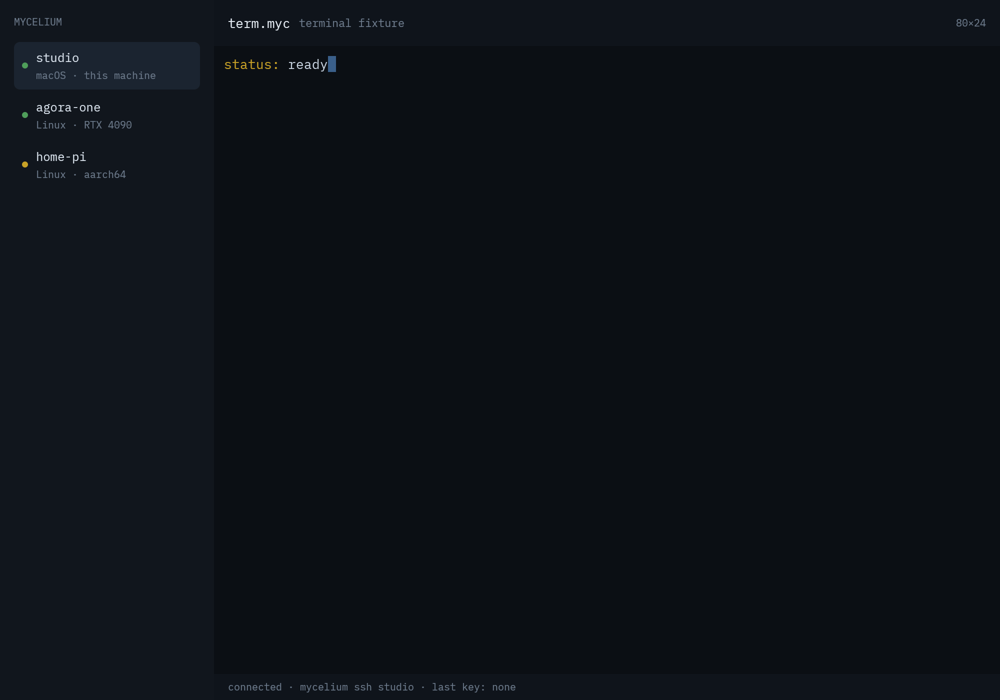

# term.myc — GPUI Spore

The terminal view, rendered by GPUI **inside** a `wasm32-wasip2` component. The
Spore owns the view and the VT grid; the host owns only the WebGPU device and
the compositor surface. No window, swapchain, or native handle crosses the
boundary.



## How it runs

```
host: wasi:webgpu instance + soil:present surface
  └─ guest: request adapter/device
       └─ WgpuContext::from_offscreen
            └─ HeadlessAppContext + TerminalView (GPUI)
                 └─ RGBA frame → host texture → present
```

The guest uses the `headless` feature added to
[`fungOS-linux/gpui-fast`](https://github.com/fungOS-linux/gpui-fast/tree/wasip2)
(`60ebb17`). That feature compiles `HeadlessAppContext` and
`WgpuHeadlessRenderer` without the native-only and `proptest` dependencies, and
`WgpuContext::from_offscreen` builds a context on a caller-supplied device.

## Build and run

```sh
cargo build --release --target wasm32-wasip2

# soil's WebGPU runner provides wasi:webgpu and soil:present.
soil-webgpu --frame term.bgr --size 1000x700 \
  target/wasm32-wasip2/release/terminal_gpui.wasm

# canvas-winit provides the live window and keyboard input.
canvas-winit target/wasm32-wasip2/release/terminal_gpui.wasm
```

`soil-webgpu` writes BGR24; the screenshot above is that frame converted to
PNG.

## What the host owns

The grid on screen is the host's: `canvas-winit` opens a pty, runs `$SHELL`
on it, feeds its output to `soil-vt`, and answers the emulator's replies back
down the same pty. The Spore asks `soil:terminal-screen` for a snapshot, draws
the cells, and sends keys back. It never sees an escape sequence, a file
descriptor, or a process.

The grid follows the window: the Spore reads `soil:present/surface` every frame,
recomputes `cols × rows` from the space it has (minus the chrome, and minus the
sidebar when it is folded), and calls `screen::resize`. A wheel notch scrolls
the viewport through scrollback; the host hands back the moved viewport, so the
Spore tracks no offset of its own.

A keystroke goes to the pty the turn it arrives, and the Spore then waits on
`soil:terminal-screen`'s `wait` rather than polling, so the echo is drawn as
soon as the emulator publishes it. An idle terminal wakes once a tick.

## Sidebar targets

The three targets in the sidebar — `studio`, `agora-one`, `home-pi` — are
fixtures, not sessions. Making them real means asking **mycelium**, which is the
thing that knows which hosts exist:

1. The target list comes from a host call backed by `soil:mycelium` — the same
   inventory the network tooling reads, not a second list kept in the view and
   not an `~/.ssh/config` scan. A host that mycelium does not know about is not
   a target.
2. Selecting one asks the host to open a session on that target. The transport
   is mycelium's business: the Spore only asks for "a process on a pty" and
   renders whatever comes back.
3. The view keeps the fixtures only until (1) exists; a target row that cannot
   be reached should say why (down, no route, no grant), which is information
   mycelium already has.

## Running a different shell on the pty

`canvas-winit --command "<line>"` runs that command line on the pty instead of a
login shell, through `sh -c`. That is how a Spore gets a **mush** shell today:

```sh
canvas-winit terminal_gpui.wasm --command "mush"
```

`mush` resolves its VFS root (`--root`, `MUSH_ROOT`, or
`~/.local/share/fungos/vfs`) and its command engine
(`--wasm`, `MUSH_WASM`, or the installed `~/.local/share/mush/module.wasm`) on
its own, so the terminal needs no knowledge of either. A Desktop-bound session
later passes `--root` and a project mount the same way.
