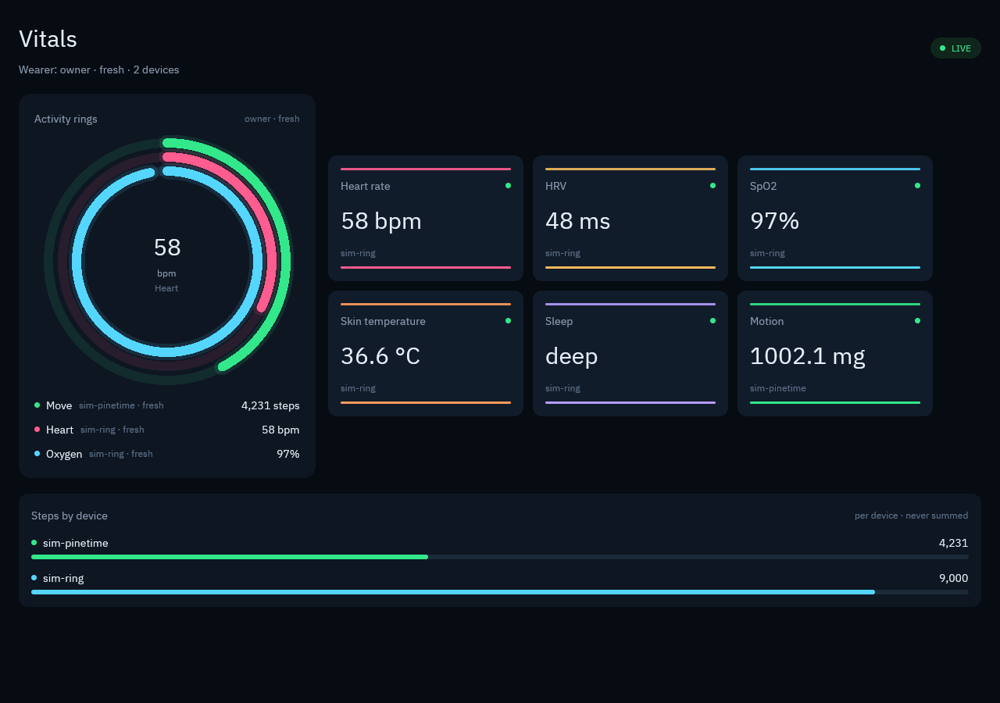

# vitals-view

A **Spore UI**, not a native companion app. The guest:

1. reads the Spore-owned `vitals.view.v1` record from `soil:records`;
2. builds the Apple Health-style activity rings, metric cards, and sleep hypnogram with **GPUI**;
3. renders them through the Soil-provided `wasi:webgpu` device using GPUI Fast's
   offscreen `WgpuHeadlessRenderer`;
4. presents the resulting texture through `soil:present`.

Canvas owns the window, compositor, input, and capture. The Spore owns the UI
structure, labels, values, units, sources, freshness, and the no-total rule. The
rings are display scales, not a second health policy: Move uses the fused
per-bucket step estimate and never a sum. No window, swapchain, or native handle
enters the guest.



## Run

Seed the records first with the headless `vitals` Spore:

```sh
soil-dev-host --records-dir .soil-dev/records spores/vitals/module.wasm seed
soil-dev-host --records-dir .soil-dev/records spores/vitals/module.wasm once --wearer owner
```

Then run the renderer through Soil's WebGPU host. It opens the records root
read-only, links `wasi:webgpu` + `soil:present` + `soil:records`, and writes
the captured frame as the same BGR24 format `soil-webgpu` already uses:

```sh
# from the soil checkout; SPORES names this checkout
cargo run -q -p soil-webgpu --bin soil-webgpu -- \
  --records-dir .soil-dev/records \
  --frame /tmp/vitals.bgr --size 1280x900 \
  "$SPORES/spores/vitals-view/module.wasm"
```

`vitals.view` is keyed by wearer and written by `vitals once`. This renderer
reads the `owner` key; an empty store renders an honest empty state rather than
inventing values or showing a guest's data.

## GPUI boundary

This uses GPUI's `headless` feature: a real GPUI window renders against
`WgpuContext::from_offscreen`, backed by `wasi:webgpu`. `soil:present` takes
the texture by borrow; the host chooses the extent and composites it.

The guest still has no authority over the window. A revoked surface closes the
lease; the Spore cannot keep drawing to a hidden window. The only font is the
bundled IBM Plex Sans face (SIL OFL 1.1); a WASI component has no system fonts.
The host supplies an empty WASI context: std's filesystem import is linked, but
with no preopens, so the Spore cannot read a host path.

The ring arcs are real GPUI path primitives. The dark/neon palette follows the
ChartGPU panel language, while the guest stays on one GPUI/wgpu pipeline instead
of adding a second GPU renderer. The sleep panel is a four-row hypnogram built
from the selected `sleep_session.stages`; it never stitches two devices into one
night.

## Layout

The renderer is responsive because Canvas chooses the texture extent, not the
Spore. It has three layouts:

- **Wide** (`>= 1100 x 880`): rings beside a two-column card grid, then sleep
  and per-device steps side by side.
- **Compact**: a phone column capped at 560 px and centered. Rings keep their
  legend in one horizontal row, tall screens show four cards, shorter screens
  show two, and the sleep timeline sits underneath.
- **Watch / flip** (`height < 560`): the title and rings only, vertically
  centered. Narrow portrait faces (under 400 px wide) also get the sleep
  timeline when it fits.

The hypnogram keeps every stage bar inside the rounded track with a 16 px
horizontal inset and centers each bar in its own stage lane. Bars are lightly
rounded segments, not pills, so they do not compete with the card corners.
Stale or expired readings still render as absent values, never zero.

## Build

```sh
cargo build --manifest-path spores/vitals-view/Cargo.toml \
  --target wasm32-wasip2 --release
cp target/wasm32-wasip2/release/vitals_view_spore.wasm module.wasm
```

GPUI Fast is a local path dependency on the `wasip2` branch. The guest's
`wgpu-wasi-webgpu` is pinned to the `wgpu-30` branch so its `wgpu` types match
`gpui_wgpu`'s wgpu 30.0.1; the Soil host still uses its wgpu-core 29 runtime on
the other side of the component boundary.
